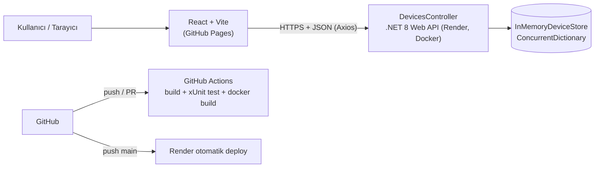

# Device Tracker API (Backend)

Staj projesi kapsamında geliştirilen, cihaz/sensör kayıtlarını yöneten .NET 8 Web API. Veriler thread-safe bir bellek içi (in-memory) depoda tutulur; uygulama Docker ile paketlenip Render üzerinde yayınlanır.

## Canlı Bağlantılar

| | Adres |
|---|---|
| Backend API | https://device-tracker-backend-kuu5.onrender.com/api/devices |
| Swagger UI | https://device-tracker-backend-kuu5.onrender.com/swagger |
| Frontend | https://mmervekayaa.github.io/device-tracker-frontend/ |
| Frontend deposu | https://github.com/mmervekayaa/device-tracker-frontend |

## Mimari



### Proje yapısı

```
device-tracker-backend/
├── Controllers/DevicesController.cs   # REST uç noktaları (GET, POST, PUT, DELETE)
├── Data/InMemoryDeviceStore.cs        # Thread-safe in-memory depo + seed verisi
├── Models/Device.cs                   # Device varlığı ve DeviceStatus enum'u
├── Models/DeviceRequest.cs            # İstek DTO'su (Data Annotations ile doğrulama)
├── DeviceTracker.Tests/               # xUnit + FluentAssertions birim testleri
├── Program.cs                         # PORT, CORS, Swagger, DI yapılandırması
├── Dockerfile                         # Multi-stage, Alpine tabanlı imaj
└── .github/workflows/backend-ci.yml   # CI pipeline
```

## Veri Modeli

| Alan | Tip | Açıklama |
|---|---|---|
| `id` | int | Benzersiz kimlik (sunucu atar) |
| `name` | string | Cihaz adı (zorunlu, 1-100 karakter) |
| `category` | string | Kategori, ör. `Sensor`, `Gateway` (zorunlu) |
| `status` | string | `Active` veya `Inactive` |
| `value` | number | Ölçüm değeri, **negatif olamaz** |
| `lastUpdated` | datetime | Son güncellenme zamanı (UTC, sunucu atar) |

## API Uç Noktaları

| Metot | Endpoint | Gövde | Başarılı yanıt | Hata yanıtları |
|---|---|---|---|---|
| GET | `/api/devices` | – | `200 OK` + cihaz listesi | – |
| GET | `/api/devices/{id}` | – | `200 OK` + cihaz | `404 Not Found` |
| POST | `/api/devices` | `DeviceRequest` | `201 Created` + `Location` header | `400 Bad Request` |
| PUT | `/api/devices/{id}` | `DeviceRequest` | `200 OK` + güncel cihaz | `400 Bad Request`, `404 Not Found` |
| DELETE | `/api/devices/{id}` | – | `204 No Content` | `404 Not Found` |

**İstek gövdesi (`DeviceRequest`):**

```json
{
  "name": "Pressure Sensor",
  "category": "Sensor",
  "status": "Active",
  "value": 12.5
}
```

**Yanıt (`Device`):**

```json
{
  "id": 4,
  "name": "Pressure Sensor",
  "category": "Sensor",
  "status": "Active",
  "value": 12.5,
  "lastUpdated": "2026-10-15T10:16:51.801Z"
}
```

**Hata yanıtları:** Doğrulama hataları `400` ile birlikte JSON olarak döner (`{ "error": "..." }` veya ASP.NET Core `ValidationProblemDetails` biçiminde `errors` nesnesi). Bulunamayan kayıtlar `404` ve `{ "error": "..." }` döner.

### Örnek istekler (curl)

```bash
API=https://device-tracker-backend-kuu5.onrender.com/api/devices

curl $API
curl $API/1
curl -X POST $API -H "Content-Type: application/json" \
  -d '{"name":"Test Sensor","category":"Sensor","status":"Active","value":12.5}'
curl -X PUT $API/1 -H "Content-Type: application/json" \
  -d '{"name":"Test Sensor","category":"Sensor","status":"Inactive","value":20}'
curl -X DELETE $API/1
```

## Yerel Geliştirme

Gereksinim: .NET 8 SDK

```bash
git clone https://github.com/mmervekayaa/device-tracker-backend.git
cd device-tracker-backend
dotnet restore DeviceTracker.sln
dotnet run --project DeviceTracker.Api.csproj
```

Uygulama `http://localhost:5109` adresinde açılır; Swagger için `http://localhost:5109/swagger`.

### Testler

```bash
dotnet test DeviceTracker.sln
```

Testler Arrange-Act-Assert desenini izler; listeleme, tekil getirme, ekleme (201), güncelleme, silme, negatif değer, boş alan, geçersiz durum ve bulunamayan kayıt (404) senaryolarını ve eşzamanlı eklemede benzersiz Id üretimini kapsar.

### Docker ile çalıştırma

```bash
docker build -t device-tracker-api .
docker run -p 8080:8080 device-tracker-api
# veya Render'daki gibi PORT ile:
docker run -e PORT=5000 -p 5000:5000 device-tracker-api
```

## Ortam Değişkenleri

| Değişken | Açıklama |
|---|---|
| `PORT` | Tanımlıysa uygulama bu portu dinler (Render bunu otomatik atar). Tanımlı değilse varsayılan port kullanılır. |
| `ASPNETCORE_ENVIRONMENT` | `Development` / `Production` |

CORS yalnızca `https://mmervekayaa.github.io` ve `http://localhost:5173` kökenlerine izin verir.

## CI/CD

- **CI (GitHub Actions, `backend-ci.yml`):** `main` dalına her push'ta ve her Pull Request'te Ubuntu runner üzerinde .NET 8 kurulur, çözüm derlenir, xUnit testleri koşturulur ve Docker imajının derlendiği doğrulanır.
- **CD (Render):** `main` dalına gelen her değişiklikte Render, `Dockerfile` ile imajı yeniden derleyip servisi yayına alır.

## Önemli Notlar

- **Render cold start:** Ücretsiz katmanda servis 15 dakika istek almazsa uykuya geçer; ilk istek 30-60 saniye sürebilir.
- **Veri kalıcılığı yok:** Veriler bellekte tutulur; servis yeniden başladığında seed verisine döner.

## Teknolojiler

- .NET 8 / ASP.NET Core Web API, C#
- Swashbuckle (Swagger UI)
- xUnit, FluentAssertions
- Docker (multi-stage, Alpine)
- GitHub Actions, Render
